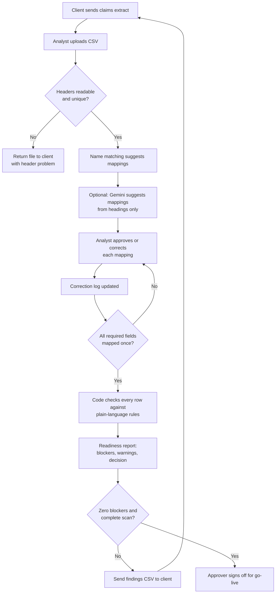

# Claims data onboarding: process map

## Who does what

| Step | Owner | AI involved? |
| --- | --- | --- |
| Upload and header check | Analyst | No |
| Mapping suggestions | Tool | Name matching always; Gemini optional, headings only |
| Approve or correct mappings | Analyst | No, this is the human decision point |
| Rule checks | Tool (code) | No, results must be exact |
| Readiness decision | Tool (code) | No |
| Plain-English summary | Tool | Optional, restricted to verified figures |
| Sign-off | Approver | No |
