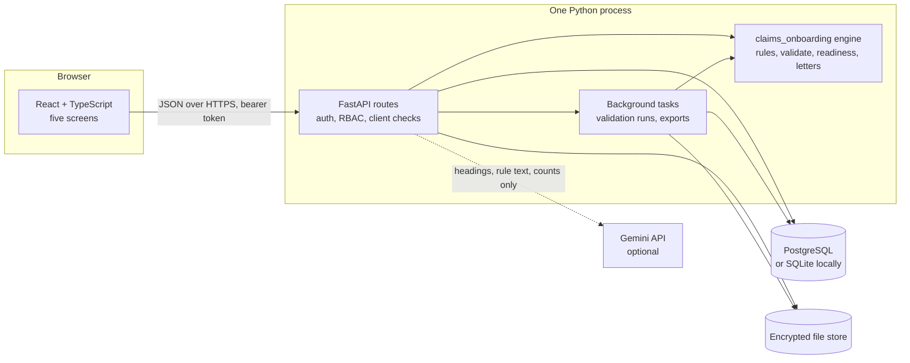
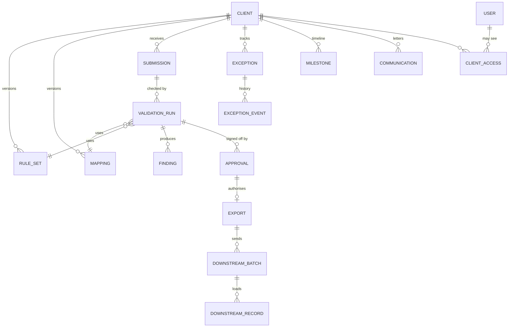
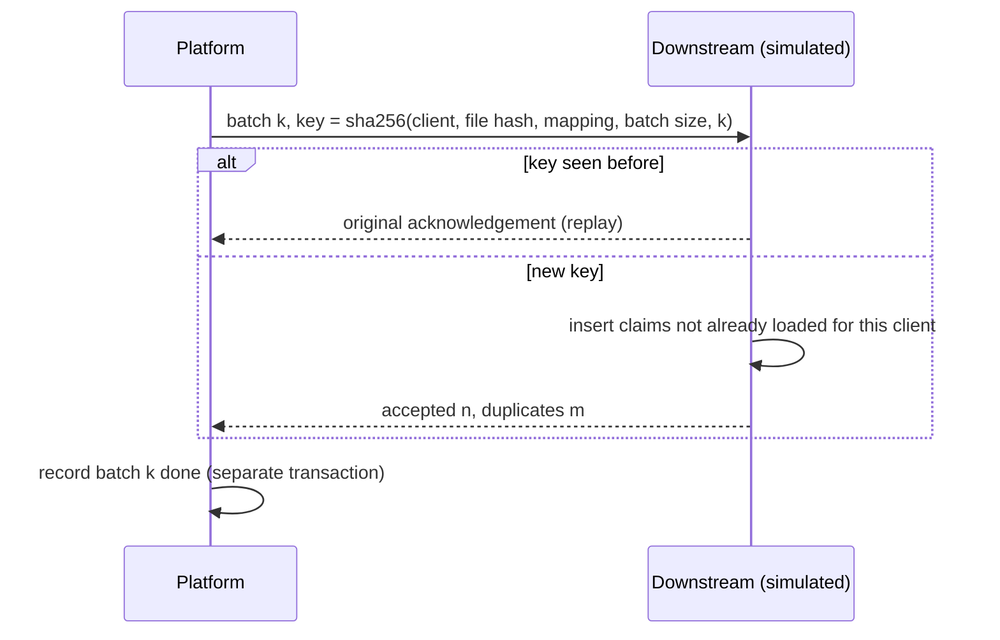

# Architecture

## Overview

| Layer | Code | Notes |
| --- | --- | --- |
| Interface | `claims_platform_web/` | React 19, TypeScript, Vite. Served by FastAPI from `dist/`. Strict content security policy, no third-party scripts or fonts at runtime |
| API | `claims_platform/api.py`, `deps.py` | Every route checks the session, the role and, for client data, access to that client |
| Workflow | `workflow.py` | Clients, rule versions, mapping approval, readiness, go-live decision |
| Processing | `processing.py` | Uploads, validation runs, exception register, recovery |
| Export | `downstream.py` | Batches, idempotency, the simulated downstream system |
| Reporting | `reporting.py`, `comms.py` | Scorecards, KPIs, metrics, evidence package, letters, explanations |
| Security | `security.py`, `storage.py`, `audit.py` | Passwords, tokens, encryption, hash-chained audit |
| Engine (reused) | `claims_onboarding/` | Plain-language rules, every-row validation, readiness facts, client letter, comparison |

The engine is the same code the original Streamlit page uses, so both give identical findings for
the same file, mapping and rules.

## Data model

Every client-owned table has `client_id`, so one helper (`deps.owned_or_404`) checks access for
any record. The audit log, users, sessions, templates and settings are platform-wide.

## Key flows

### Validation run

1. `POST /api/submissions/{id}/runs` checks that an approved mapping and rule set exist and fit the
   file, creates a run in `queued`, records it in the audit trail, and returns `202`.
2. A background task moves it to `running`, decrypts the file, validates every row with the
   approved rule version, and writes the findings, the run result, the exception updates, the audit
   entry and the milestones **in one transaction**.
3. On an error the run is marked `failed` with the reason. On a crash the run stays `running` until
   start-up recovery marks it `interrupted`. Either can be retried; nothing half-written exists to
   clean up.

### Exception register

Exceptions are grouped by field, rule and severity, not by line, because resubmitted files reorder
rows. After a completed run of the latest file:

- a group not seen before is **opened**;
- a group no longer present is **resolved**, but only if the whole file was read;
- a resolved group that appears again is **reopened**, with its history kept;
- an accepted warning whose row count grows is reopened for review.

People can assign owners, move between open and in progress, add notes, and (approvers only)
accept a warning with a reason. Nobody can resolve an exception by hand or accept a blocker.

### Export and idempotency

The downstream commit and the platform's progress record are separate transactions, as with a real
external system. If the acknowledgement is lost, the retry replays the same key and is answered from
the downstream record, so no claim is loaded twice. A unique constraint on (client, claim ID) is
the last line of defence across exports.

## Security design

| Control | Implementation |
| --- | --- |
| Passwords | scrypt (n=2^14, r=8, p=1), random salt, constant-time compare; minimum 12 characters |
| Sessions | Random 256-bit bearer tokens; only the SHA-256 is stored; 8-hour expiry; revoked on sign-out, password change or account disable |
| Lockout | 5 failed sign-ins lock the account for 15 minutes; administrators can unlock |
| Roles | Administrator, implementation analyst, approver, client data contact; checked on every route |
| Client separation | Access list per user; a record of another client returns 404, the same as a record that does not exist |
| Four-eyes | Mapping, rule-change and go-live approvals refuse the person who prepared the work, including administrators |
| Encryption at rest | Fernet (AES-128-CBC with HMAC-SHA256) for uploaded files, finding values, letters and downstream payloads |
| Audit | Each entry's SHA-256 covers the previous hash; a locked head row prevents forks; `GET /api/audit/verify` recomputes the chain |
| HTTP | CSP without inline scripts, `X-Frame-Options: DENY`, `nosniff`, `no-store` on API responses |
| AI | Gemini sees column headings, rule text and counts, never cell values; its output is checked and can only suggest or reword |

See the [security and risk assessment](security-and-risk.md) for what these controls do not cover.

## Limits of the pilot design

- **One process.** Background work runs inside the web process (FastAPI background tasks) and
  start-up recovery assumes it is the only worker. More workers need a job queue with leases
  (for example PostgreSQL `SKIP LOCKED` or Redis) and recovery based on lease expiry.
- **Schema by `create_all`.** There are no migrations yet; adopt Alembic before the first schema change in production.
- **File storage on local disk.** Use object storage with server-side encryption and a key manager in production.
- **Findings detail cap.** All findings are counted, but the first 5,000 per run are stored with their values (as in the engine).
- **Simulated downstream.** The receiver lives in the same database. A real integration needs its own contract and reconciliation.
