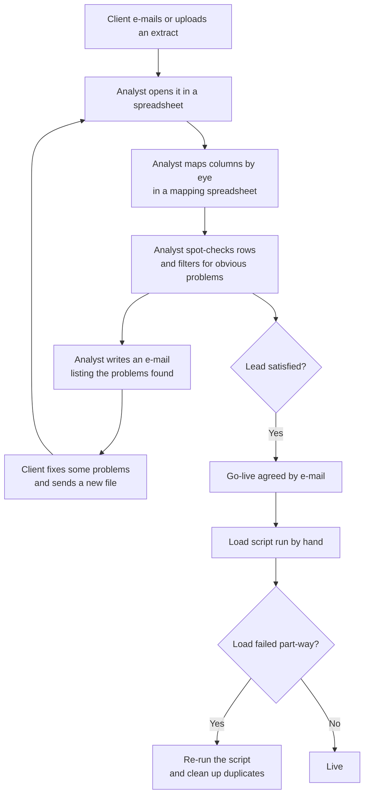
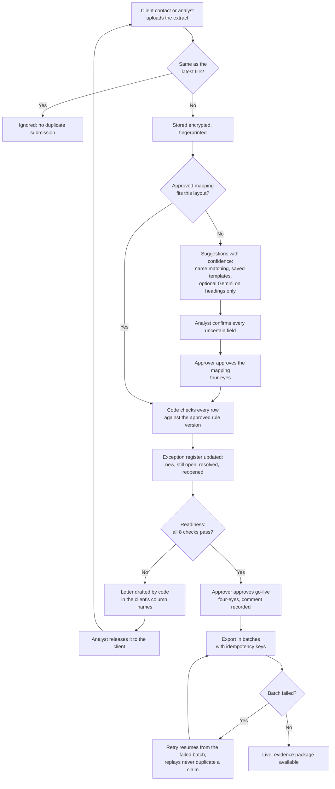

# Process maps: current and future state

## Current state (manual)

How onboarding typically runs without the platform: spreadsheets, e-mail and a shared folder.
This is a description of the common pattern, not a measurement of any specific team.

### Pain points

| # | Where | Problem |
| --- | --- | --- |
| 1 | Mapping | Mapped by eye; nothing records who decided, or whether an ambiguous column (two NPI columns) was checked |
| 2 | Checking | Rows are sampled, not all checked; results depend on the analyst |
| 3 | Rules | Rules live in people's heads or an old document; changes are not versioned |
| 4 | Resubmission | Which problems were fixed, which are new, which came back: worked out by hand each round |
| 5 | Exceptions | Tracked in e-mail threads; no owner, status or history |
| 6 | Go-live | Agreed by e-mail; nothing stops approval while known blockers remain |
| 7 | Load | A failure part-way can duplicate claims on re-run |
| 8 | Evidence | Assembling proof of the decision afterwards takes days, if possible at all |
| 9 | Measurement | Rounds, rework and time to resolve are not recorded, so they cannot be improved |

## Future state (with the platform)

### What changes

| Pain point | Future state | Control |
| --- | --- | --- |
| 1 Mapping by eye | Suggestions with confidence; uncertain fields must be ticked; a second person approves | AC-1, P1-03 |
| 2 Sampling | Every row checked by code | P1-04 |
| 3 Unversioned rules | Plain-language rules per client, versioned, approved by a second person | P1-02 |
| 4 Manual comparison | Automatic comparison per rule group: fixed, still open, new | P1-06 |
| 5 E-mail exceptions | Exception register with owner, status, notes and history | P1-05 |
| 6 Approval with blockers | Approval is blocked by the readiness checks | AC-2 |
| 7 Duplicate loads | Idempotent batches and per-claim dedupe | AC-3 |
| 8 Evidence after the fact | Evidence package generated on demand, with a hash manifest | P2-04 |
| 9 No measurement | Scorecards and portfolio KPIs from the records | P2-01 |

## Swimlane: who does what

| Step | Client contact | Analyst | Approver | Platform (code) | AI (optional) |
| --- | --- | --- | --- | --- | --- |
| Upload | Uploads | Uploads | | Dedupes, encrypts, fingerprints | |
| Mapping | | Confirms or changes | Approves or returns | Suggests with confidence; enforces confirmation | Suggests from headings only |
| Rules | | Proposes a change | Approves or rejects | Parses; refuses unclear rules | |
| Validation | | Starts the run | | Checks every row; updates exceptions | Never |
| Exceptions | Adds notes | Assigns, sets status | Accepts warnings with a note | Resolves automatically when absent from a full scan | Rewords explanations on request |
| Letters | Reads released letters | Drafts and releases | May release | Writes the letter from findings | |
| Go-live | | | Approves or rejects | Blocks approval unless all checks pass | |
| Export | | Starts, resumes | | Batches, dedupes, records | |
